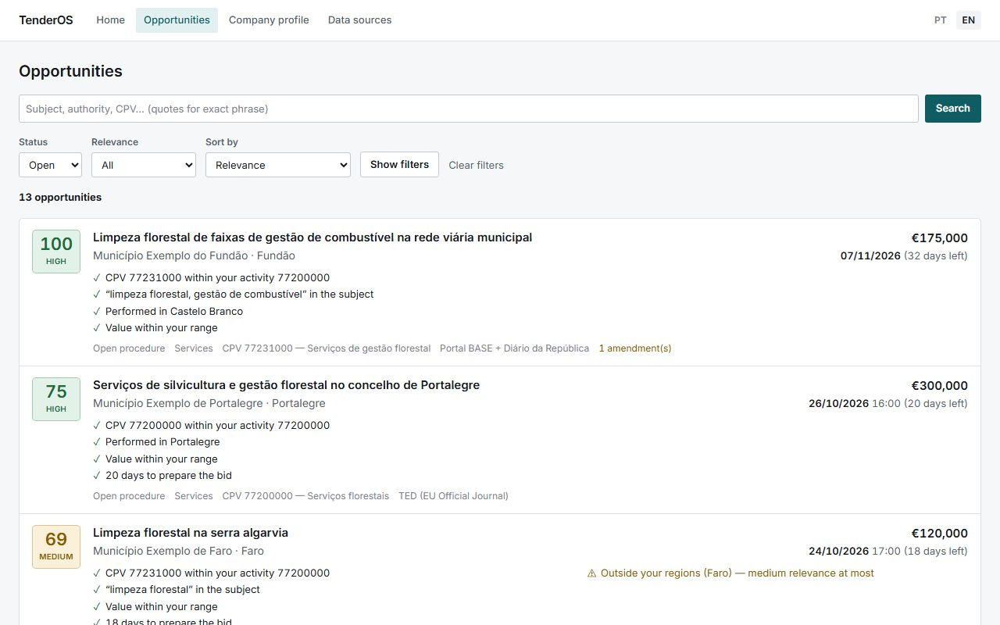
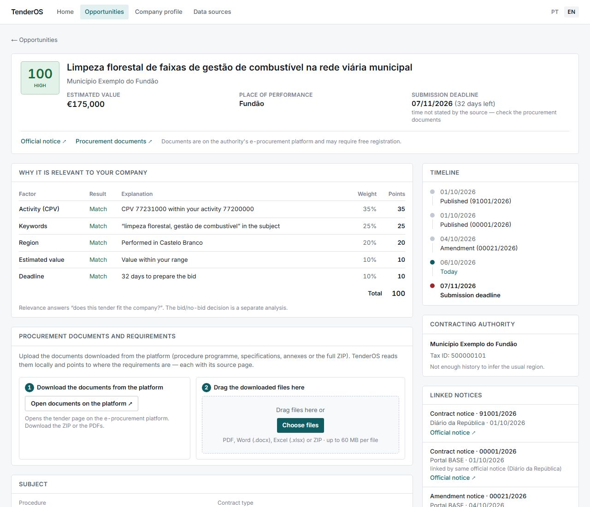
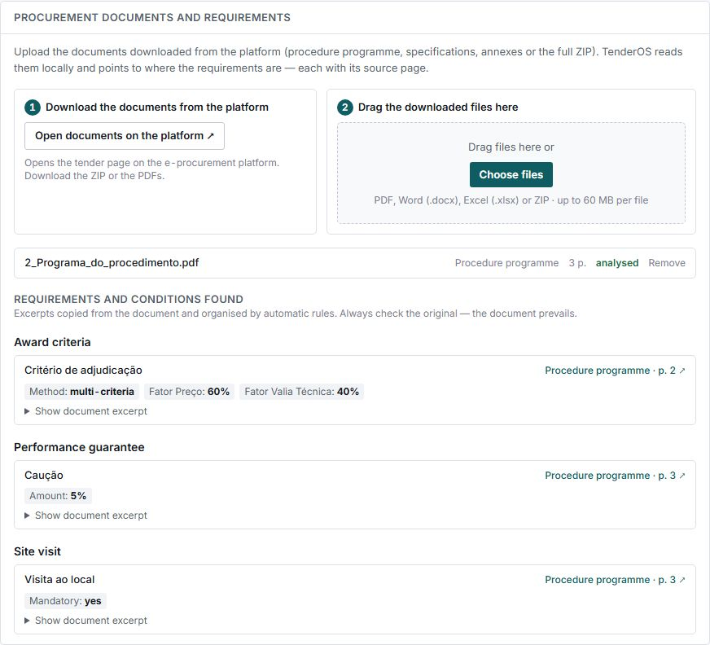
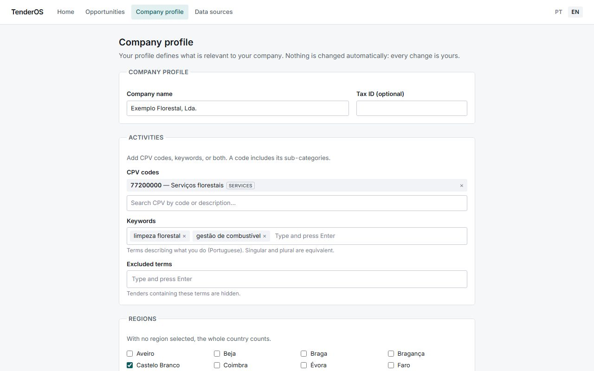

# TenderOS

Finds the Portuguese public tenders worth a company's time, explains why each one matters, and
reads the procurement documents to show what a bid requires. Every fact can be traced back to the
official source.

## Why I built it

I wanted a project that dealt with messy real-world data instead of a tidy tutorial dataset, and that
solved a problem someone would actually pay to have solved. Portuguese public procurement fits both:
daily PDFs, weekly exports, inconsistent identifiers and no single source of truth, while small
companies depend on spotting the right tender in time. TenderOS is my attempt to turn all of that
into something a small company could check over morning coffee.

## Screenshots

Opportunities ranked for a company profile, with the reasons and the warnings for each score:

The score broken down factor by factor, the timeline of publications and amendments, and the
notices that were merged into one opportunity:

Requirements read from an uploaded procedure programme, each linked to its page:

The company profile that drives the ranking:

The screenshots use an invented test dataset.

## What it does

- Collects tenders from the three official sources (the Diário da República on the day they are
  published, Portal BASE and the EU's TED) and merges the copies of each notice into one opportunity.
- Keeps the history of every amendment, field by field, and records where each value came from.
- Scores each tender against a company profile (CPV codes, keywords, regions, value range) and shows
  how every point was earned. Tenders outside the company's regions or far outside its value range
  cannot be ranked as highly relevant.
- Reads uploaded procurement documents (PDF, Word, Excel, ZIP), with OCR for scanned pages, and pulls
  out award criteria and weights, guarantees, permits, standards, contract terms and site visits,
  each with the page it came from.
- Portuguese and English interface.

## How it's built

- **API:** .NET 10 and ASP.NET Core, organised as a modular monolith: domain, connectors, document
  analysis, persistence and HTTP live in separate projects, and the domain is free of any framework.
- **Data:** PostgreSQL with Portuguese full-text search; ingestion runs in the background with
  incremental cursors, so unchanged files are never downloaded twice.
- **Web:** Next.js (App Router, server components) with React and Tailwind CSS. The browser never
  talks to the API directly.
- **Documents:** PdfPig, Open XML SDK, PDFium and Tesseract, all running locally.
- **Tests:** over 190 automated tests (unit, connector and integration tests against a real
  PostgreSQL) plus browser tests with Playwright, all run in CI.

## Interesting problems

- **Reading the official PDFs.** The Diário da República has no API, only a daily RSS of PDFs. The
  parser reads the numbered sections by label and copes with page footers, wrapped values and
  letter-spaced headings; it was checked against a full real edition (119 of 120 notices read).
- **One tender, three sources.** The Diário da República PDF and the Portal BASE record of the same
  notice share an official document id, so they are merged exactly rather than by comparing titles.
  Amendments are linked to what they change, and a source that disagrees never silently overwrites
  a value.
- **A score you can audit.** Each factor's points are rounded with the largest-remainder method, so
  the breakdown always adds up to the score. Missing data counts as unknown, never as a penalty.
- **Rule-based document analysis with local OCR.** Requirements are found by the documents' section
  headings and read only from the quoted text, so every result points to the page it came from. It
  runs offline and costs nothing per document.
- **Browser tests that can be exact.** Playwright runs against its own database, reset to a fixed
  dataset before every test, so the tests check exact rankings and counts instead of "at least one
  result".

## What's next

- User accounts and several companies per installation
- Alerts: a private RSS feed, a calendar of deadlines and a daily email digest
- Market analysis from awarded contracts: who wins similar tenders and at what price
- Prior information notices as "upcoming tenders"

The source code is kept in a private repository. If you'd like to see it, reach out on [LinkedIn](https://www.linkedin.com/in/alexandre-magno-382a813b2/).

---

© 2026 Alexandre Magno. All rights reserved.
